# 3. MLP

!!! abstract "Enunciado"

    [Exercises → MLP](https://insper.github.io/ann-dl/2026.2/exercises/mlp/){:target='_blank'} · prazo **13.out.2026**

!!! note "Reprodutibilidade"

    Semente única em todo o relatório: `random_state=42` na geração dos dados e no
    `train_test_split`, e `np.random.seed(42)` na inicialização dos pesos. A exceção é o
    Exercício 4, que repete o treino com as sementes de inicialização 42, 54 e 67 (os dados
    continuam fixos em 42). Cada script gera as
    suas figuras e imprime os números citados no texto. A partir da raiz do repositório:

    ```shell
    python docs/exercises/mlp/code/exercise2.py
    python docs/exercises/mlp/code/exercise3.py
    python docs/exercises/mlp/code/exercise4.py
    ```

## Exercise 1

**Cálculo manual de um passo de treino**

### Abordagem

Um passo completo de treino (forward, loss, backward e atualização) feito à mão para uma MLP
com 2 entradas, 2 neurônios ocultos com tanh e 1 saída com tanh, usando o erro quadrático
como loss. Os dados do enunciado são:

| Item | Valor |
|---|---|
| Entrada | $x = [0.5,\ -0.2]$ |
| Alvo | $y = 1$ |
| Pesos da camada oculta | $W^{(1)} = \begin{bmatrix} 0.3 & -0.1 \\ 0.2 & 0.4 \end{bmatrix}$ |
| Viés da camada oculta | $b^{(1)} = [0.1,\ -0.2]$ |
| Pesos da saída | $W^{(2)} = [0.5,\ -0.3]$ |
| Viés da saída | $b^{(2)} = 0.2$ |
| Learning rate | $\eta = 0.3$ |
| Loss | $L = (y - \hat{y})^2$ |

As contas foram feitas no caderno, com 4 casas decimais. Conferi todos os valores com NumPy, e
eles batem até a última casa, exceto por um arredondamento em $W^{(2)}_1$ (0.5867 no caderno,
0.5866 com mais casas).

### A — Forward

**Pré-ativações da camada oculta**, $z^{(1)} = W^{(1)} x + b^{(1)}$:

$$
\begin{aligned}
z^{(1)}_1 &= 0.3 \cdot 0.5 + (-0.1)(-0.2) + 0.1 = 0.27 \\
z^{(1)}_2 &= 0.2 \cdot 0.5 + 0.4 \cdot (-0.2) - 0.2 = -0.18
\end{aligned}
$$

**Ativações da camada oculta**, $h^{(1)} = \tanh(z^{(1)})$:

$$
h^{(1)} = [\tanh(0.27),\ \tanh(-0.18)] \approx [0.2636,\ -0.1781]
$$

**Pré-ativação da saída**, $u^{(2)} = W^{(2)} h^{(1)} + b^{(2)}$:

$$
u^{(2)} = 0.5 \cdot 0.2636 + (-0.3)(-0.1781) + 0.2 \approx 0.3852
$$

**Saída**, $\hat{y} = \tanh(u^{(2)}) \approx 0.3672$.

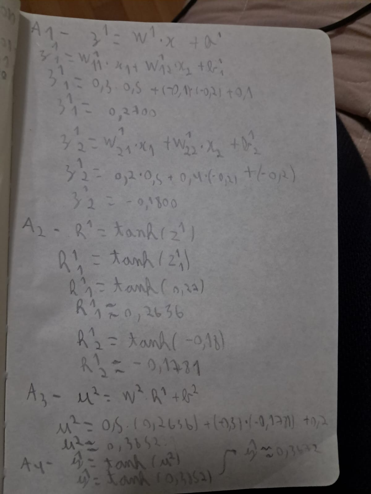{ width="500" }
/// caption
**Caderno, página 1** — Forward: pré-ativações e ativações da camada oculta, pré-ativação e
saída da rede.
///

**Loss**:

$$
L = (1 - 0.3672)^2 \approx 0.4004
$$

### B — Backward

**Gradiente da loss em relação à saída.** Com $r = y - \hat{y}$, $L = r^2$, e pela regra
da cadeia:

$$
\frac{\partial L}{\partial \hat{y}} = \frac{\partial L}{\partial r}\cdot\frac{\partial r}{\partial \hat{y}}
= 2r \cdot (-1) = -2(y - \hat{y}) \approx -1.2655
$$

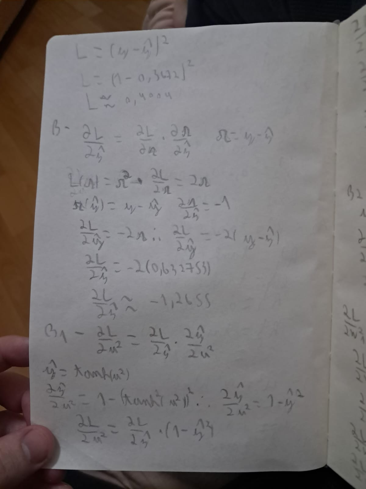{ width="500" }
/// caption
**Caderno, página 2** — Loss e gradientes $\partial L / \partial \hat{y}$ e
$\partial L / \partial u^{(2)}$.
///

**Pela tanh da saída**, usando $\tanh'(u) = 1 - \tanh^2(u) = 1 - \hat{y}^2$:

$$
\frac{\partial L}{\partial u^{(2)}} = \frac{\partial L}{\partial \hat{y}}\,(1 - \hat{y}^2)
\approx -1.2655 \cdot (1 - 0.3672^2) \approx -1.0948
$$

**Gradientes da camada de saída.** Como $u^{(2)} = W^{(2)}_1 h^{(1)}_1 + W^{(2)}_2 h^{(1)}_2 + b^{(2)}$,
as derivadas parciais são $h^{(1)}_1$, $h^{(1)}_2$ e $1$:

$$
\begin{aligned}
\frac{\partial L}{\partial W^{(2)}_1} &= -1.0948 \cdot 0.2636 \approx -0.2886 \\
\frac{\partial L}{\partial W^{(2)}_2} &= -1.0948 \cdot (-0.1781) \approx 0.1950 \\
\frac{\partial L}{\partial b^{(2)}} &= -1.0948 \cdot 1 \approx -1.0948
\end{aligned}
$$

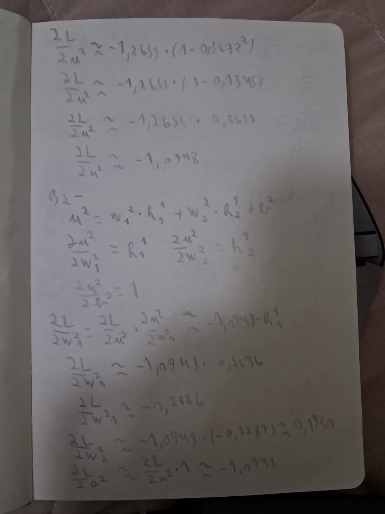{ width="500" }
/// caption
**Caderno, página 3** — Valor de $\partial L / \partial u^{(2)}$ e gradientes de $W^{(2)}$ e
$b^{(2)}$.
///

**Propagação para a camada oculta.** Como $\partial u^{(2)} / \partial h^{(1)}_i = W^{(2)}_i$:

$$
\frac{\partial L}{\partial h^{(1)}} = \frac{\partial L}{\partial u^{(2)}}\, W^{(2)}
\approx [-1.0948 \cdot 0.5,\ -1.0948 \cdot (-0.3)] = [-0.5474,\ 0.3284]
$$

**Pela tanh da camada oculta**, com $\partial h^{(1)}_i / \partial z^{(1)}_i = 1 - (h^{(1)}_i)^2$:

$$
\frac{\partial L}{\partial z^{(1)}} = \frac{\partial L}{\partial h^{(1)}} \odot \big(1 - (h^{(1)})^2\big)
\approx [-0.5474 \cdot (1 - 0.2636^2),\ 0.3284 \cdot (1 - 0.1781^2)] = [-0.5094,\ 0.3180]
$$

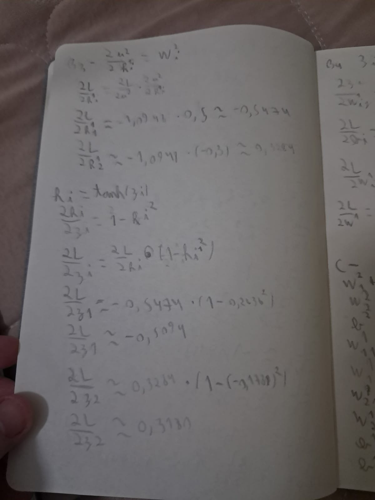{ width="500" }
/// caption
**Caderno, página 4** — Propagação para a camada oculta: $\partial L / \partial h^{(1)}$ e
$\partial L / \partial z^{(1)}$.
///

**Gradientes da camada oculta.** Como $z^{(1)}_i = W^{(1)}_{i1} x_1 + W^{(1)}_{i2} x_2 + b^{(1)}_i$,
vale $\partial z^{(1)}_i / \partial W^{(1)}_{ij} = x_j$ e $\partial z^{(1)}_i / \partial b^{(1)}_i = 1$.
Em forma matricial:

$$
\frac{\partial L}{\partial W^{(1)}} = \frac{\partial L}{\partial z^{(1)}}\, x^\top
= \begin{bmatrix} -0.5094 \cdot 0.5 & -0.5094 \cdot (-0.2) \\ 0.3180 \cdot 0.5 & 0.3180 \cdot (-0.2) \end{bmatrix}
\approx \begin{bmatrix} -0.2547 & 0.1019 \\ 0.1590 & -0.0636 \end{bmatrix}
$$

$$
\frac{\partial L}{\partial b^{(1)}} = \frac{\partial L}{\partial z^{(1)}} \approx [-0.5094,\ 0.3180]
$$

### C — Atualização dos parâmetros

Gradiente descendente com $\eta = 0.3$, ou seja, $\theta \leftarrow \theta - 0.3\, \partial L / \partial \theta$:

| Parâmetro | Antes | Gradiente | Depois |
|---|---:|---:|---:|
| $W^{(2)}_1$ | 0.5 | −0.2886 | 0.5866 |
| $W^{(2)}_2$ | −0.3 | 0.1950 | −0.3585 |
| $b^{(2)}$ | 0.2 | −1.0948 | 0.5284 |
| $W^{(1)}_{11}$ | 0.3 | −0.2547 | 0.3764 |
| $W^{(1)}_{12}$ | −0.1 | 0.1019 | −0.1306 |
| $W^{(1)}_{21}$ | 0.2 | 0.1590 | 0.1523 |
| $W^{(1)}_{22}$ | 0.4 | −0.0636 | 0.4191 |
| $b^{(1)}_1$ | 0.1 | −0.5094 | 0.2528 |
| $b^{(1)}_2$ | −0.2 | 0.3180 | −0.2954 |

A saída era $\hat{y} \approx 0.37$ e o alvo é $1$, então a rede precisa aumentar $\hat{y}$.
Todas as atualizações vão nessa direção: o viés da saída sobe bastante (0.2 → 0.53), $W^{(2)}_1$
sobe porque $h^{(1)}_1$ é positivo, e $W^{(2)}_2$ fica mais negativo porque $h^{(1)}_2$ é
negativo. Nos dois casos, o produto $W^{(2)}_i h^{(1)}_i$ aumenta.

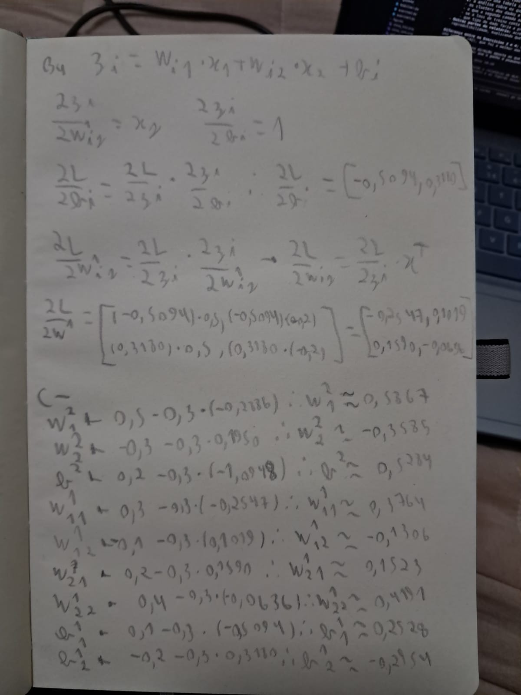{ width="500" }
/// caption
**Caderno, página 5** — Gradientes de $W^{(1)}$ e $b^{(1)}$ e atualização de todos os
parâmetros com $\eta = 0.3$.
///

## Exercise 2

**Binary Classification a Straight Line Cannot Do**

### Abordagem

Gerei os dados do enunciado sem alterar nenhum parâmetro: 1000 pontos em 2D, com a classe 0
num único cluster centrado na origem e a classe 1 dividida em dois clusters, em $(3, 3)$ e
$(-3, -3)$ — um de cada lado da classe 0. A divisão é 80/20 estratificada (800 treino, 200
teste). Antes da rede, ajustei uma regressão logística como *baseline* linear. Depois treinei
uma MLP escrita do zero em NumPy, como uma classe que recebe a lista de tamanhos das camadas
(`sizes`), de modo que o mesmo código serve para qualquer profundidade e é reaproveitado no
Exercício 3.

``` { .python .copy .select linenums='1' title="docs/exercises/mlp/code/exercise2.py" }
--8<-- "docs/exercises/mlp/code/exercise2.py"
```

### A — Gerar os dados

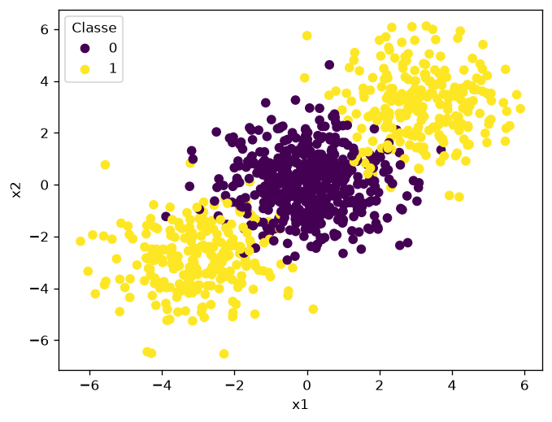
/// caption
**Figura 1** — Os 1000 pontos coloridos por $y$. A classe 1 (amarelo) aparece em dois grupos,
nos cantos superior direito e inferior esquerdo, com a classe 0 (roxo) no meio.
///

### B — Baseline linear

A regressão logística treinada no conjunto de treino obtém **47,5 %** de acurácia no teste —
pior que um palpite, já que as classes estão balanceadas (50 %).

### C — Implementação da MLP

A rede é composta por camadas densas com **tanh** nas camadas ocultas e **sigmoid** na saída.

- **Forward:** para cada camada $l$, $Z^{(l)} = A^{(l-1)} W^{(l)} + b^{(l)}$ e
  $A^{(l)} = \tanh(Z^{(l)})$; na última, $\hat{y} = \sigma(Z^{(L)})$. As ativações de todas
  as camadas ficam guardadas para o backward.
- **Loss:** binary cross-entropy,
  $L = -\frac{1}{n}\sum_i \big[y_i \log \hat{y}_i + (1 - y_i)\log(1 - \hat{y}_i)\big]$.
- **Backward (derivado à mão):** na saída, o par sigmoid + BCE simplifica para
  $\frac{\partial L}{\partial Z^{(L)}} = \frac{1}{n}(\hat{y} - y)$. A partir daí, para cada
  camada, $\frac{\partial L}{\partial W^{(l)}} = A^{(l-1)\top}\, \delta^{(l)}$,
  $\frac{\partial L}{\partial b^{(l)}} = \sum_i \delta^{(l)}_i$, e o gradiente é propagado
  para trás com $\delta^{(l-1)} = \big(\delta^{(l)} W^{(l)\top}\big) \odot \big(1 - (A^{(l-1)})^2\big)$,
  usando que $\tanh'(z) = 1 - \tanh^2(z)$.
- **Update:** gradiente descendente em lote completo, $W \leftarrow W - \eta\, \partial L / \partial W$
  e $b \leftarrow b - \eta\, \partial L / \partial b$.
- **Inicialização:** pesos $\sim \mathcal{N}(0, 1)/\sqrt{n_\text{entrada}}$ e vieses zerados.

| Item | Valor |
|---|---|
| Arquitetura | `[2, 8, 1]` — 2 entradas, 8 neurônios ocultos (tanh), 1 saída (sigmoid) |
| Learning rate | 0.1 |
| Épocas | 2000 (lote completo) |
| Acurácia no treino | 96,5 % |
| **Acurácia no teste** | **91,5 %** |

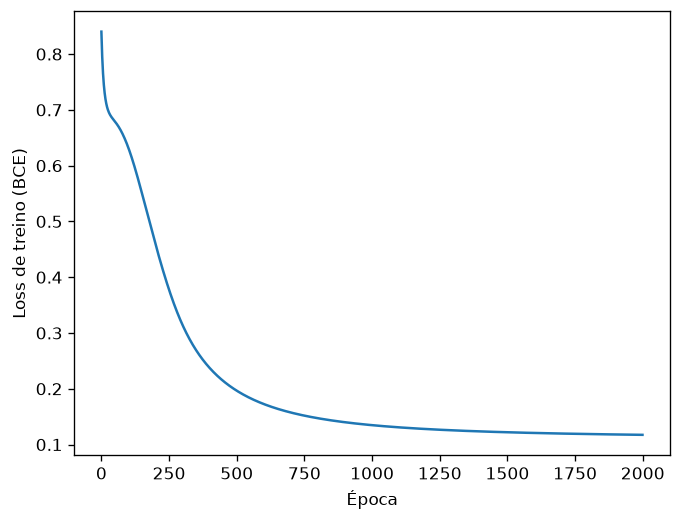
/// caption
**Figura 2** — Loss de treino (BCE) × época. A curva cai de 0.84 para 0.12. Há um pequeno
platô em torno de 0.69 nas primeiras ~100 épocas: $0.69 \approx \ln 2$ é a loss de quem prevê
50 % para tudo, e é o ponto em que a rede ainda se comporta como um modelo linear, antes de os
neurônios ocultos se especializarem.
///

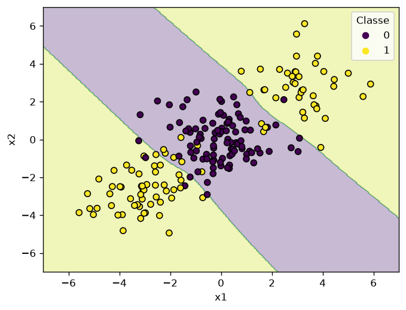
/// caption
**Figura 3** — Fronteira de decisão da MLP, avaliada numa grade $300 \times 300$, com os 200
pontos de teste por cima. A região roxa é a classe 0 e as regiões amarelas, a classe 1.
///

### D — Análise

**Por que o baseline linear fica abaixo de 50 % enquanto a MLP passa de 90 %?**

Na Figura 3, a região que a rede atribui à classe 1 é formada por **duas regiões separadas**,
uma em cada canto, fora de uma faixa diagonal que contém a classe 0. Essa faixa é limitada por
duas fronteiras aproximadamente paralelas, perpendiculares à direção $(1, 1)$ que liga os dois
clusters da classe 1.

Uma única reta divide o plano em dois semiplanos, e cada semiplano é uma região só, conexa e
convexa. Não há como uma reta deixar os dois clusters da classe 1 do mesmo lado e a classe 0
do outro, porque a classe 0 está exatamente no segmento entre eles. Qualquer reta que passe
perto da origem deixa um cluster da classe 1 de cada lado. Uma reta afastada deixa tudo do
mesmo lado. Nos dois casos a acurácia fica em torno de 50 %.

A regressão logística confirma isso: os coeficientes aprendidos são quase zero
($w \approx [0.030,\ 0.001]$). Como os dois clusters da classe 1 são simétricos em relação
à origem, os gradientes de um cancelam os do outro, e o modelo termina praticamente constante,
prevendo ~0.5 para todo ponto. A classificação passa a depender do lado em que cada ponto cai
de uma fronteira quase arbitrária, e o resultado (47,5 %) é ruído em torno do acaso.

A camada oculta resolve isso: cada neurônio tanh desenha a sua própria fronteira linear, e a
camada de saída combina essas fronteiras. Com duas delas, a rede já forma a faixa da Figura 3,
uma região que nenhuma reta sozinha consegue produzir.

## Exercise 3

**Multi-Class, Same Network**

### Abordagem

Os dados agora têm 1500 amostras, 4 features informativas e 3 classes, com 2 clusters por
classe (6 clusters no total), divididos em 80/20 estratificado (1200 treino, 300 teste, 100
por classe). A classe `MLP` do Exercício 2 foi reaproveitada, e só mudaram a saída, a loss e o
formato de $y$. O **backward e o update ficaram idênticos**.

``` { .python .copy .select linenums='1' title="docs/exercises/mlp/code/exercise3.py" }
--8<-- "docs/exercises/mlp/code/exercise3.py"
```

### B — Adaptar a rede

| Parte | Exercício 2 | Exercício 3 |
|---|---|---|
| Unidades de saída | 1 | 3 |
| Ativação de saída | sigmoid | softmax |
| Loss | binary cross-entropy | categorical cross-entropy |
| Formato de $y$ | coluna com 0/1 | one-hot, `np.eye(3)[y]` |
| Predição | $\hat{y} \geq 0.5$ | $\arg\max_k p_k$ |
| Backward / update | — | **sem alteração** |

**Derivada de softmax + cross-entropy.** Seja $u$ o vetor de logits de um exemplo,

$$
p_i = \frac{e^{u_i}}{\sum_j e^{u_j}}, \qquad L = -\sum_k y_k \log p_k ,
$$

com $y$ one-hot. A derivada da softmax é

$$
\frac{\partial p_k}{\partial u_i} = p_k\,(\delta_{ki} - p_i),
$$

onde $\delta_{ki} = 1$ se $k = i$ e $0$ caso contrário. Pela regra da cadeia,

$$
\frac{\partial L}{\partial u_i}
= -\sum_k \frac{y_k}{p_k}\, p_k\,(\delta_{ki} - p_i)
= -\sum_k y_k\,\delta_{ki} + p_i \sum_k y_k
= -y_i + p_i \sum_k y_k .
$$

Como $y$ é one-hot, $\sum_k y_k = 1$, e portanto

$$
\boxed{\frac{\partial L}{\partial u} = p - y}
$$

É exatamente a mesma expressão do par sigmoid + BCE. O $\frac{1}{p_k}$ que vem do logaritmo
cancela o $p_k$ que vem da derivada da softmax. Por isso a linha `dZ = (self.A[-1] - y) / n`
do backward vale para os dois exercícios sem nenhuma mudança (o $\frac{1}{n}$ vem da média
sobre os exemplos). Na implementação, a softmax subtrai o máximo de cada linha antes do
`exp`, só para evitar estouro numérico; o resultado é o mesmo.

### C — Treinar e avaliar

| Item | Valor |
|---|---|
| Arquitetura | `[4, 16, 3]` — 4 entradas, 16 neurônios ocultos (tanh), 3 saídas (softmax) |
| Learning rate | 0.1 |
| Épocas | 2000 (lote completo) |
| Inicialização | $\mathcal{N}(0, 1)/\sqrt{n_\text{entrada}}$, semente 42 |
| Acurácia no treino | 87,1 % |
| **Acurácia no teste** | **84,7 %** |

Outras configurações testadas ficaram todas na mesma faixa: `[4, 16, 3]` com lr 0.3 deu
85,0 % e `[4, 32, 16, 3]` com lr 0.1 e 3000 épocas deu 85,7 %. Ou seja, o resultado não
depende de um ajuste fino dos hiperparâmetros.

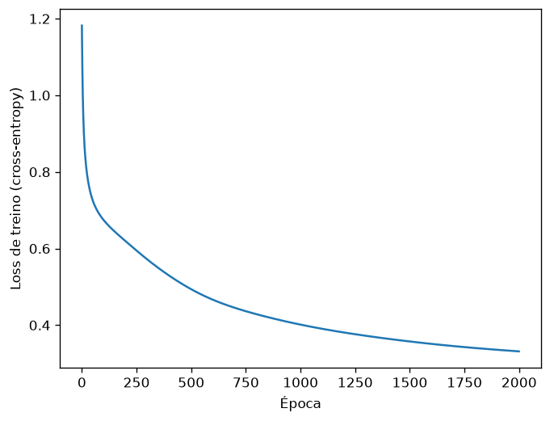
/// caption
**Figura 4** — Loss de treino (categorical cross-entropy) × época. Começa em 1.18, perto de
$\ln 3 \approx 1.10$ (a loss de um palpite uniforme entre 3 classes), e termina em 0.33.
///

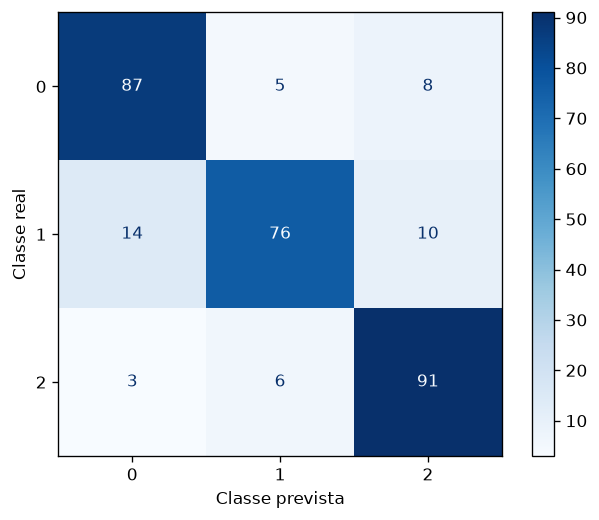
/// caption
**Figura 5** — Matriz de confusão no teste (linhas: classe real; colunas: classe prevista).
///

### D — Análise

**Qual par de classes a rede mais confunde?**

O par **(0, 1)**: 14 exemplos da classe 1 previstos como 0 e 5 da classe 0 previstos como 1,
19 erros no total. O par (1, 2) vem logo atrás com 16 erros (10 + 6), e o par (0, 2) é o
menos confundido, com 11 (8 + 3). A classe 1 é a que tem o pior recall (76 %), contra 87 % da
classe 0 e 91 % da classe 2.

**Explicação a partir da estrutura dos dados.** O `make_classification` coloca os centros
dos clusters nos vértices de um hipercubo 4D de lado $2 \times$ `class_sep` $= 2$, ou seja, em
pontos com coordenadas $\pm 1$. São 16 vértices e 6 clusters, sorteados entre eles. Estimei
os centros com k-means (2 grupos por classe) e eles caem, aproximadamente, nos sinais:

| Classe | Cluster a | Cluster b |
|---|---|---|
| 0 | $(+, -, +, +)$ | $(-, -, -, -)$ |
| 1 | $(-, +, -, -)$ | $(-, +, +, +)$ |
| 2 | $(-, +, -, +)$ | $(+, +, +, -)$ |

Dois vértices **vizinhos** no hipercubo diferem em uma única coordenada e estão a distância 2
um do outro, enquanto os outros pares estão a $2\sqrt{2}$ ou mais. Com dispersão unitária,
clusters vizinhos se sobrepõem bastante.

- O cluster $(-,-,-,-)$ da classe 0 e o $(-,+,-,-)$ da classe 1 são vizinhos: diferem só em
  $x_2$. Isso explica o par mais confundido.
- A classe 1 tem os seus dois clusters vizinhos de clusters da classe 2: $(-,+,-,-)$ e
  $(-,+,+,+)$ estão ambos a uma coordenada de $(-,+,-,+)$. Daí os 16 erros do par (1, 2).
- As classes 0 e 2 **não têm nenhum par de clusters vizinhos** (diferem sempre em pelo menos
  duas coordenadas), e são as menos confundidas.

A classe 1 fica no "meio" das outras duas, com vizinhos dos dois lados, e por isso tem o pior
recall. Os pares (0, 1) e (1, 2) ficam próximos na contagem de erros porque a sobreposição
real também depende da covariância aleatória que o `make_classification` aplica a cada
cluster, não só da distância entre os centros.

**Baseline logístico.** A regressão logística multinomial obtém **66,3 %** no teste, contra
84,7 % da MLP. Um classificador linear multiclasse divide o espaço em regiões **convexas**,
uma por classe. Aqui cada classe é a união de dois clusters em vértices opostos do hipercubo,
com clusters de outras classes entre eles. Uma região convexa que contenha os dois clusters de
uma classe tem que conter também o que está entre eles.

A camada oculta adiciona justamente a capacidade de formar regiões **não convexas e
desconexas**. Cada neurônio oculto traça um hiperplano, e a camada de saída combina esses
hiperplanos para atribuir à mesma classe dois clusters distantes, como no Exercício 2. Os
cerca de 15 % de erro que sobram vêm da sobreposição entre clusters vizinhos, que nenhuma
fronteira consegue remover.

## Exercise 4

**Does a Second Hidden Layer Help?**

### Abordagem

Comparação controlada: os mesmos dados e o mesmo split do Exercício 3 (`random_state=42`), a
mesma classe `MLP` sem nenhuma alteração, o mesmo learning rate (0.1) e o mesmo número de
épocas (2000). A única diferença é a profundidade: `[4, 16, 3]` contra `[4, 16, 16, 3]`.
Cada rede foi treinada com 3 sementes de inicialização dos pesos (42, 54 e 67), e os
números reportados são a média das três. Os dados não mudam com a semente: se mudassem, a
comparação estaria medindo datasets diferentes, e não arquiteturas diferentes.

``` { .python .copy .select linenums='1' title="docs/exercises/mlp/code/exercise4.py" }
--8<-- "docs/exercises/mlp/code/exercise4.py"
```

### A — Treinar a rede mais profunda

| Item | Valor |
|---|---|
| Arquitetura | `[4, 16, 16, 3]` — 4 entradas, duas camadas ocultas de 16 neurônios (tanh), 3 saídas (softmax) |
| Learning rate | 0.1 (igual ao Exercício 3) |
| Épocas | 2000 (igual ao Exercício 3) |
| **Acurácia no teste** | **84,9 %** (média de 3 sementes) |

### B — Comparar

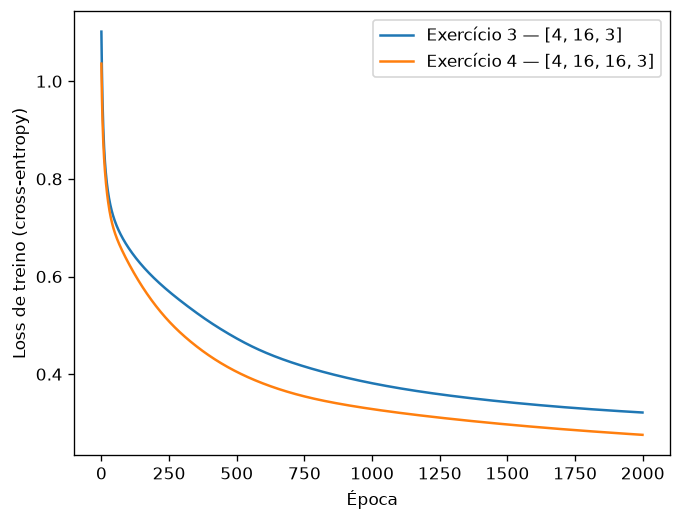
/// caption
**Figura 6** — Loss de treino × época das redes do Exercício 3 (1 camada oculta) e do
Exercício 4 (2 camadas ocultas). Cada curva é a média das 3 sementes.
///

| | camadas ocultas | parâmetros | loss final de treino | acurácia de treino | acurácia no teste |
|---|---:|---:|---:|---:|---:|
| Exercício 3 | 1 | 131 | 0.322 | 88,1 % | 83,9 % |
| Exercício 4 | 2 | 403 | 0.276 | 90,1 % | 84,9 % |

Médias de 3 sementes. Os resultados de cada semente:

| Rede | Semente | Loss final | Acurácia de treino | Acurácia no teste |
|---|---:|---:|---:|---:|
| `[4, 16, 3]` | 42 | 0.332 | 87,1 % | 84,7 % |
| `[4, 16, 3]` | 54 | 0.312 | 88,8 % | 83,7 % |
| `[4, 16, 3]` | 67 | 0.321 | 88,6 % | 83,3 % |
| `[4, 16, 16, 3]` | 42 | 0.279 | 90,0 % | 85,0 % |
| `[4, 16, 16, 3]` | 54 | 0.269 | 89,8 % | 85,0 % |
| `[4, 16, 16, 3]` | 67 | 0.279 | 90,3 % | 84,7 % |

A média do Exercício 3 aqui (83,9 %) é um pouco menor que os 84,7 % reportados no Exercício
3, porque aquele valor é de uma única semente (42), que por acaso foi a melhor das três.

### C — Análise

**O que foi medido.** A rede com duas camadas ocultas ganhou **cerca de 1 ponto** no teste
(84,9 % contra 83,9 %), e foi melhor nas três sementes. Mas o ganho é pequeno e custou 3 vezes
mais parâmetros (403 contra 131). A profundidade não mudou a natureza do resultado: as duas
redes ficam na mesma faixa de 83–86 % que o enunciado esperava para o Exercício 3.

**Quantos clusters os dados têm e que fronteira eles precisam.** São 6 clusters gaussianos,
2 por classe, nos vértices de um hipercubo 4D (Exercício 3, item D). Para classificá-los,
basta uma fronteira que junte dois clusters em cada classe. Isso é uma combinação de alguns
hiperplanos, e uma camada oculta com 16 neurônios já consegue fazer isso. O erro que sobra
(~15 %) vem da sobreposição entre clusters vizinhos: ali, pontos de classes diferentes
ocupam a mesma região do espaço, e nenhuma fronteira, por mais complexa que seja, separa
esses pontos.

**O que a segunda camada acrescenta e o que ela custa.** Em termos de representação, a
segunda camada permite combinar as fronteiras da primeira e formar regiões mais complexas.
Esses dados não precisam disso. Em termos de otimização, ela traz mais parâmetros e um
gradiente que atravessa mais uma tanh antes de chegar à primeira camada. Aqui esse custo não
apareceu: a Figura 6 mostra a rede mais funda descendo mais rápido e terminando mais baixo.
Com 403 parâmetros, ela tem mais graus de liberdade para se ajustar ao conjunto de treino.

**A loss de treino conta a mesma história que a acurácia de teste?** Não. A loss final de
treino caiu 14 % (0.322 → 0.276) e a acurácia de treino subiu 2 pontos, mas a acurácia de
teste subiu só 1 ponto. A diferença entre treino e teste aumentou de 4,2 para 5,2 pontos.
Parte da melhora que a Figura 6 mostra é a rede se ajustando melhor ao próprio conjunto de
treino, e não aprendendo uma fronteira que generaliza melhor. Pela Figura 6 sozinha, a
conclusão seria que a profundidade ajuda bastante. O teste mostra que ajuda pouco.

**Que tipo de dado faria a profundidade compensar.** Dados com estrutura **composicional**,
em que a fronteira é feita de padrões que se repetem ou que se constroem uns sobre os outros.
Exemplos são um tabuleiro de xadrez com muitas casas, espirais entrelaçadas com várias voltas
ou imagens, em que a primeira camada detecta bordas e a segunda combina bordas em formas. Nesses
casos, uma rede rasa precisaria de muito mais neurônios para formar a mesma fronteira que uma
rede funda forma reutilizando as features da camada anterior. Seis clusters gaussianos não
têm essa estrutura, e por isso a segunda camada quase não ajuda.

## Results summary

| # | Métrica | Valor |
|---|---------|-------|
| 1 | Loss antes da atualização | 0.4004 |
| 2 | Acurácia no teste — baseline linear | 47,5 % |
| 2 | Acurácia no teste — MLP `[2, 8, 1]` | **91,5 %** |
| 3 | Acurácia no teste — baseline linear | 66,3 % |
| 3 | Acurácia no teste — MLP `[4, 16, 3]` | **84,7 %** |
| 3 | Par mais confundido | (0, 1), 19 erros em 300 |
| 4 | Acurácia no teste — `[4, 16, 3]`, média de 3 sementes | 83,9 % |
| 4 | Acurácia no teste — `[4, 16, 16, 3]`, média de 3 sementes | **84,9 %** |

## Discussão

Os dois exercícios contam a mesma história com dimensões diferentes: quando uma classe é a
união de grupos separados por outra classe, nenhum modelo linear consegue representá-la. No
Exercício 2 isso é extremo — o baseline fica no acaso, porque a simetria dos clusters anula
o sinal linear. No Exercício 3 o efeito é parcial (66 %), porque alguns clusters ainda são
separáveis linearmente das outras classes. Nos dois casos, uma única camada oculta pequena
foi suficiente para fechar a maior parte da diferença.

A outra lição é de implementação. Graças à identidade $\partial L / \partial u = p - y$, que
vale tanto para sigmoid + BCE quanto para softmax + cross-entropy, passar de binário para
multiclasse exigiu mudar só a ativação de saída, a loss e o formato de $y$. O forward, o
backward e o update foram reaproveitados sem alteração. O Exercício 4 reaproveitou a mesma
classe de novo, mudando só a lista `sizes`.

Por fim, mais profundidade não é sinônimo de melhor. A segunda camada oculta reduziu a loss
de treino de forma visível, mas o ganho no teste foi de 1 ponto. Os dados do Exercício 3 já
são bem resolvidos por uma camada, e o erro restante é sobreposição entre clusters, não falta
de capacidade do modelo.

## Conclusão

A MLP implementada do zero atingiu 91,5 % no problema binário e 84,7 % no problema de 3
classes, dentro das faixas esperadas pelo enunciado e bem acima dos baselines lineares
(47,5 % e 66,3 %). O que a camada oculta acrescenta é a possibilidade de formar regiões de
decisão não convexas e desconexas. O erro que sobra no Exercício 3 é explicado pela
sobreposição entre clusters vizinhos no hipercubo. Adicionar uma segunda camada oculta
(Exercício 4) melhorou a loss de treino mas só 1 ponto no teste (83,9 % → 84,9 %, média de 3
sementes), porque esses dados não têm a estrutura composicional que tornaria a profundidade
útil.
