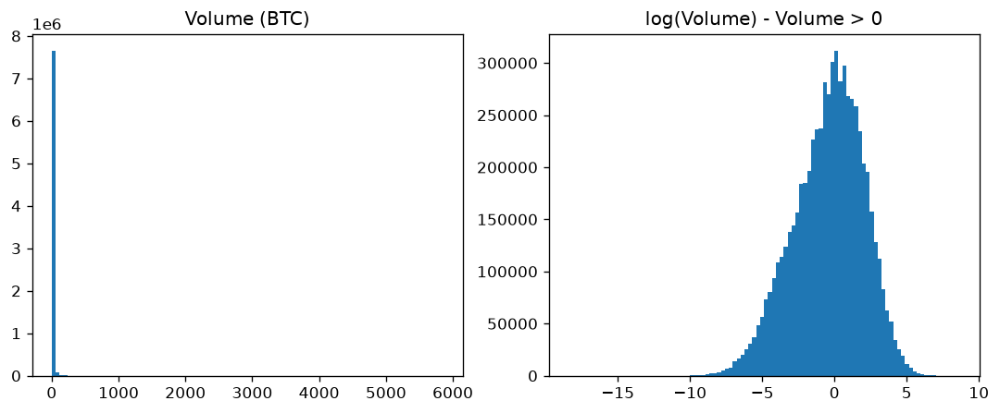
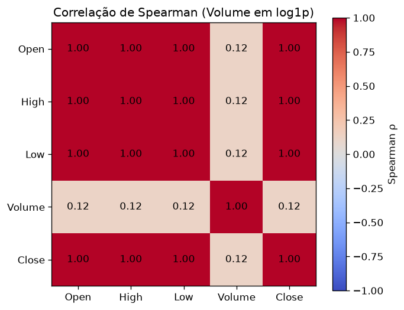
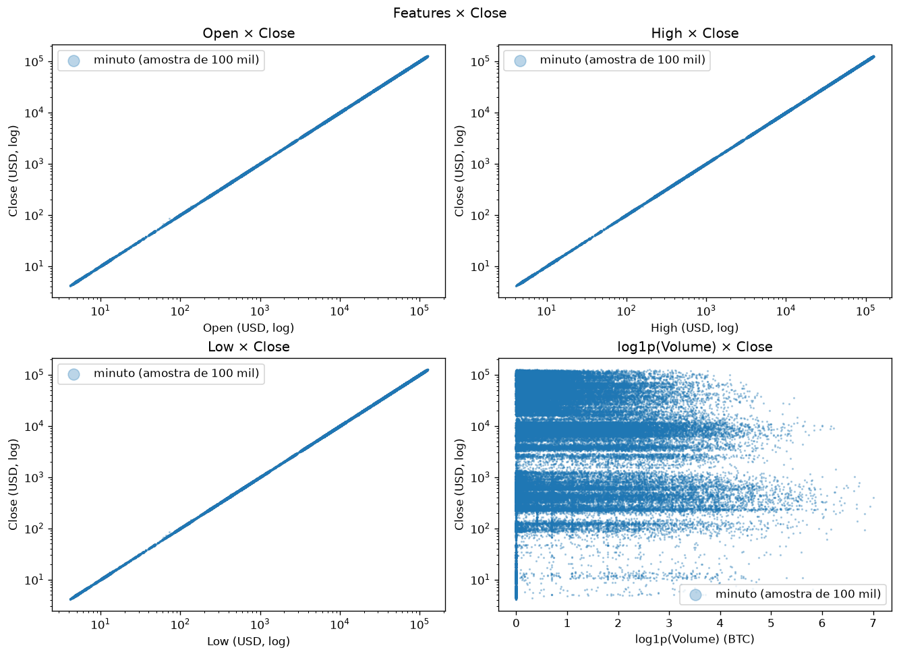
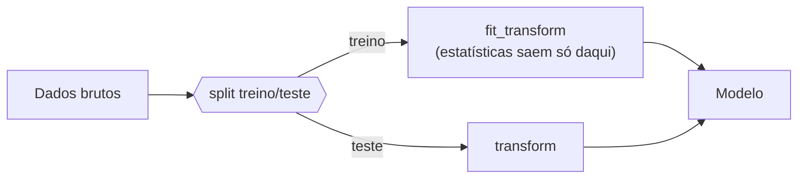
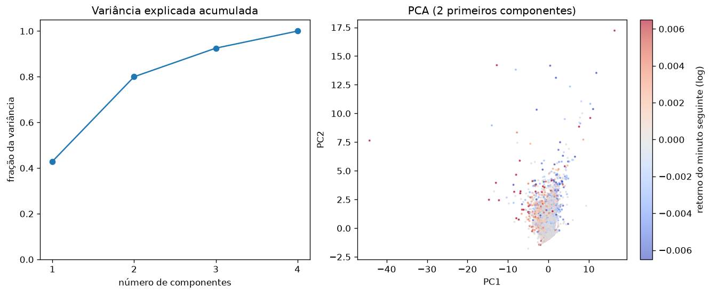
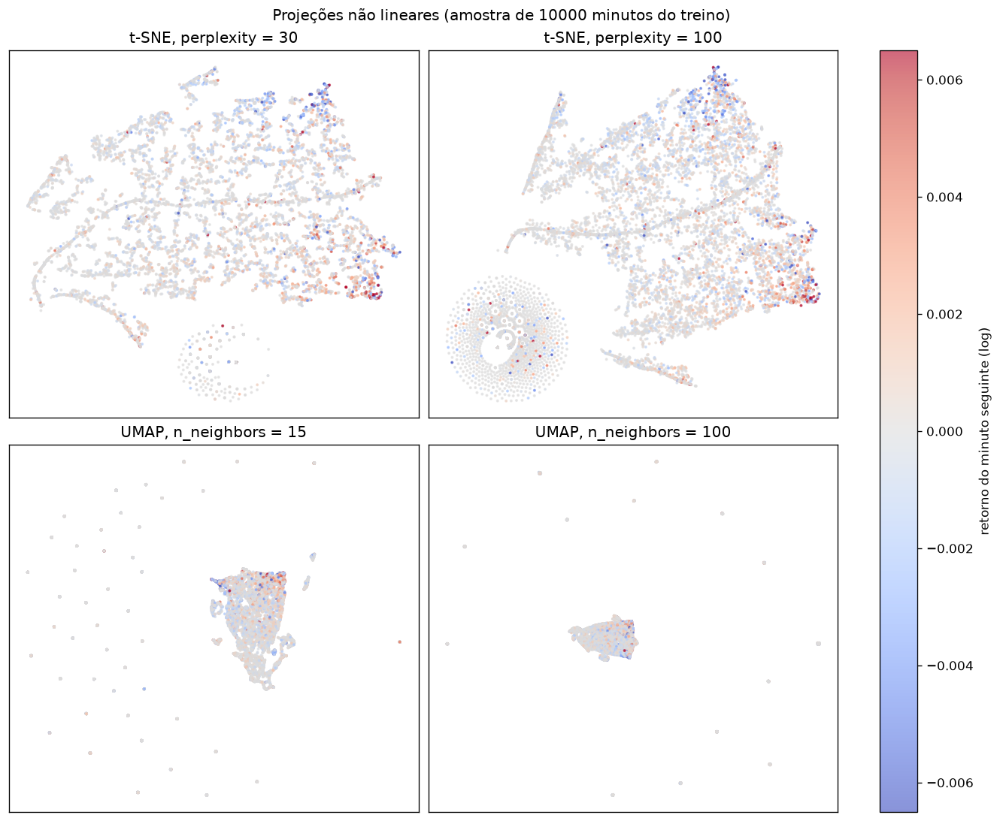

# 1. EDA — Análise Exploratória

!!! abstract "Entrega 1 de 3 do [Projeto](../index.md)"

    [Projects → EDA](https://insper.github.io/ann-dl/2026.2/projects/eda/){:target='_blank'} · prazo **08.out.2026**

!!! info "Equipe"

    | Nome completo | GitHub |
    |---------------|--------|
    |Theo França |TheoRibeiroFranca |
    |Lucas Sato Coelho de Oliveira |lucassatoco |
    |Rafael Kauffmann |RafaelKauffmann |

    Dataset, decisões e status: [página do projeto](../index.md).

!!! tip "O que esta entrega decide"

    O EDA não é um álbum de gráficos: é onde a equipe **escolhe o dataset** e descobre o que
    vai atrapalhar o treino depois — desbalanceamento, vazamento, escalas incompatíveis com a
    ativação, ausências não aleatórias. Cada achado aqui deve virar uma linha do plano de
    pré-processamento no fim da página, e é esse plano que as duas entregas
    seguintes executam.

    As aulas de **Classes → Data** no
    [site da disciplina](https://insper.github.io/ann-dl/){:target='_blank'} dão a estrutura:
    tipos, distribuições, qualidade, desbalanceamento, vazamento, split e pré-processamento.

## 1. Dataset

| | |
|---|---|
| **Nome** | Bitcoin Historical Data (`btcusd_1-min_data.csv`) |
| **Fonte** | [Kaggle — mczielinski/bitcoin-historical-data](https://www.kaggle.com/datasets/mczielinski/bitcoin-historical-data){:target='_blank'}, dados da exchange **Bitstamp** |
| **Licença** | [CC BY-SA 4.0](https://creativecommons.org/licenses/by-sa/4.0/){:target='_blank'} |
| **Versão** | 745 (393,95 MB) |
| **Período** | 2012-01-01 00:01 → 2026-10-06 03:43 (UTC) |
| **Dimensões** | 7 764 703 linhas × 6 colunas |
| **Tarefa** | Regressão — prever o preço de fechamento (`Close`) |

**O que é cada linha:** uma janela de **1 minuto** de negociação do par BTC/USD na Bitstamp,
no formato OHLCV (*Open, High, Low, Close, Volume*). A série é contínua: a diferença entre
timestamps consecutivos é sempre de 60 s, sem buracos nem timestamps repetidos — minutos sem
negócio aparecem com `Volume = 0` e o preço repetido do minuto anterior (16,9% das linhas).

**Por que este dataset:** é uma série temporal longa (quase 15 anos), limpa e de domínio
público, com milhões de amostras — volume suficiente para treinar uma rede neural — e um alvo
contínuo natural para regressão. Também cobre regimes muito diferentes de preço (de US$ 3,80
a US$ 126 mil), o que torna o pré-processamento (escala, retornos, split temporal) uma parte
real do problema.

## 2. Estrutura e tipos

7 764 703 amostras, 1 coluna de tempo, 4 features numéricas e 1 alvo. No arquivo bruto, o
pandas lê `Timestamp` como `int64` e o resto como `float64`; o `Timestamp` está com o tipo
errado — é um instante em *Unix time* (segundos desde 1970-01-01 UTC), não uma quantidade —
e é convertido com `pd.to_datetime(..., unit="s")` e usado como índice da série.

| Feature | Tipo | Unidade | Significado | Cardinalidade / faixa | Observação |
|---------|------|---------|-------------|-----------------------|------------|
| `Timestamp` | data/hora (lida como `int64`) | s (Unix, UTC) | Início da janela de 60 s | 7 764 703 valores únicos; 2012-01-01 → 2026-10-06 | Identificador da linha → vira índice, não feature |
| `Open` | numérica contínua | USD | Preço da primeira negociação da janela | 3,80 – 126 202 | — |
| `High` | numérica contínua | USD | Maior preço negociado na janela | 3,80 – 126 272 | — |
| `Low` | numérica contínua | USD | Menor preço negociado na janela | 3,80 – 126 158 | — |
| `Close` | numérica contínua | USD | Preço da última negociação da janela | 3,80 – 126 202 | **Alvo** |
| `Volume` | numérica contínua | BTC | Quantidade de bitcoin negociada na janela | 0 – 5 853,85 | 16,9% de zeros (minutos sem negócio) |

Nenhuma coluna tem valores ausentes e não há linhas duplicadas (detalhes na seção 6).

!!! warning "Atenção para a parte B"

    `Open`, `High` e `Low` são do **mesmo minuto** que o `Close`: usá-los para prever o
    `Close` daquele minuto é vazamento (`Low ≤ Close ≤ High` por construção). O alvo terá de
    ser o `Close` de um instante **futuro**, usando só informação passada.

## 3. Variável alvo

O alvo é o preço de fechamento `Close` (regressão).

| Série | Média | Desvio | Mín | Q1 | Mediana | Q3 | Máx | Assimetria |
|-------|-------|--------|-----|----|---------|----|-----|------------|
| `Close` (USD) | 24 335 | 31 708 | 3,80 | 470,40 | 8 255 | 40 903 | 126 202 | 1,32 |


/// caption
**Figura 1** — Histograma do `Close` em USD (esq.) e de `log(Close)` (dir.).
///

- **Preço bruto:** assimetria positiva forte (1,32), com média três vezes maior que a mediana.
  Um terço dos minutos tem preço abaixo de US$ 1 000, porque o bitcoin passou anos barato.
  Por isso aparece o pico perto de zero na Figura 1. A distribuição não tem "forma": é o
  histórico de quanto tempo o preço passou em cada patamar.
- **log(Close):** comprime as 4,5 ordens de grandeza (US$ 3,80 → US$ 126 mil) e remove a
  assimetria positiva, mas continua com vários picos, um por regime de mercado.
- Não há zeros nem censura: o preço não tem teto nem piso artificiais.

!!! question "Responda"

    Não há classes, então não há desbalanceamento.

## 4. Análise univariada

### A. Numéricas

As quatro features são numéricas contínuas. Estatísticas calculadas no dataset inteiro
(7 764 703 minutos):

| Feature | Média | Desvio | Mín | Q1 | Mediana | Q3 | Máx | Assimetria | % zeros |
|---------|-------|--------|-----|----|---------|----|-----|------------|---------|
| `Open` (USD) | 24 335 | 31 708 | 3,80 | 470,39 | 8 255,79 | 40 902 | 126 202 | 1,32 | 0% |
| `High` (USD) | 24 343 | 31 717 | 3,80 | 470,78 | 8 262 | 40 924 | 126 272 | 1,32 | 0% |
| `Low` (USD) | 24 327 | 31 700 | 3,80 | 470,07 | 8 250 | 40 880 | 126 158 | 1,32 | 0% |
| `Volume` (BTC) | 4,92 | 21,46 | 0 | 0,022 | 0,441 | 2,73 | 5 853,85 | **28,52** | 16,9% |

**Critério das figuras:** `Open`, `High` e `Low` têm a mesma distribuição do `Close`
(estatísticas praticamente iguais e correlação de 1,0), então a Figura 1 já mostra a forma das
três e repetir os histogramas não muda nenhuma decisão. A única feature com forma diferente é
o `Volume`.

- **`Open`, `High`, `Low`:** iguais ao `Close` (seção 3). Assimetria positiva (1,32), média
  três vezes maior que a mediana, um pico perto de zero no preço bruto e, em log, vários
  picos (um por regime de mercado). Em nível são redundantes com o alvo; a informação nova
  está nas diferenças entre eles (`High − Low` mede a volatilidade do minuto, `Close − Open`
  a direção), que ficam para a engenharia de features.


/// caption
**Figura 2** — Histograma do `Volume` em BTC (esq.) e de `log(Volume)` só para os minutos com
negócio, `Volume > 0` (dir.).
///

- **`Volume` bruto:** assimetria extrema (28,52). A mediana é 0,44 BTC, mas o máximo passa de
  5 800 BTC, e quase todos os minutos ficam numa única barra perto de zero na Figura 2.
- **Zeros:** 16,9% dos minutos têm `Volume = 0` (minutos sem negócio, seção 6). Eles formam
  uma massa separada que não aparece no gráfico em log.
- **`log(Volume)`, só `Volume > 0`:** quase simétrico (assimetria −0,38) e com **uma única
  moda**, perto de 1 BTC por minuto (mediana de 0,84 BTC entre os minutos com negócio).
  Ou seja, o volume é aproximadamente log-normal: em escala log ele se comporta bem, e é
  nessa escala que deve entrar no modelo.

Os outliers de cada feature estão na seção 6.

### B. Categóricas

O dataset **não tem variáveis categóricas**: são o tempo (`Timestamp`) e cinco colunas
numéricas contínuas. Não há frequências nem cardinalidade a reportar, nem categorias raras
ou de alta cardinalidade. Variáveis categóricas que podem ser derivadas do tempo (hora do
dia, dia da semana) e o indicador de minuto sem negócio (`Volume = 0`) têm cardinalidade
fixa e baixa (24, 7 e 2 valores) e ficam para a engenharia de features.

## 5. Análise bivariada e correlações

Relação entre as features e o alvo, e entre as features.

!!! danger "Correlação alta demais com o alvo é suspeita"

    Uma feature que prevê o alvo quase perfeitamente costuma ser **vazamento**: informação
    que só existe depois do fato que você quer prever. Investigue antes de comemorar.

### A. Numérica × numérica

**Método: Spearman.** As distribuições são muito assimétricas (assimetria de 1,32 nos preços
e de 28,52 no `Volume`, seção 4). Além disso, o preço passa por 4,5 ordens de grandeza. O
Pearson mede só relação linear e é dominado pelos valores extremos. O Spearman usa os postos,
então mede qualquer relação monotônica e não é afetado pela cauda. O `Volume` entra como
`log1p(Volume)`, a mesma escala da seção 4. Para o Spearman isso não muda nada, porque
`log1p` preserva a ordem, mas é a escala em que o volume aparece nos gráficos.
Estatísticas calculadas no dataset inteiro (7 764 703 minutos).

| | `Open` | `High` | `Low` | `log1p(Volume)` | `Close` |
|---|---|---|---|---|---|
| `Open` | 1 | 1,000000 | 1,000000 | 0,1246 | 1,000000 |
| `High` | 1,000000 | 1 | 0,999999 | 0,1248 | 1,000000 |
| `Low` | 1,000000 | 0,999999 | 1 | 0,1244 | 1,000000 |
| `log1p(Volume)` | 0,1246 | 0,1248 | 0,1244 | 1 | 0,1246 |
| `Close` | 1,000000 | 1,000000 | 1,000000 | 0,1246 | 1 |


/// caption
**Figura 3** — Correlação de Spearman entre as features e o alvo, com o `Volume` em
`log1p`.
///

**Conclusão:** os quatro preços formam um bloco com ρ ≥ 0,999999, e o `Volume` está fora
dele, com ρ ≈ 0,12 contra todos.


/// caption
**Figura 4** — `Open`, `High`, `Low` e `log1p(Volume)` contra o `Close`, numa amostra de
100 000 minutos (`random_state=42`). Preços em escala log.
///

**Conclusão:** `Open`, `High` e `Low` desenham a mesma reta contra o `Close`, e o `Volume`
não mostra nenhuma relação visível com o preço.

- **Pares redundantes:** `Open`, `High`, `Low` e `Close` (todos os pares com ρ = 1,000000,
  exceto `High` × `Low` com 0,999999). Num minuto o preço varia muito pouco perto da escala
  de US$ 3,80 a US$ 126 mil, então o nível de um preço praticamente determina os outros.
  Em nível, os três preços carregam a mesma informação, e basta um deles. A informação
  nova está nas diferenças entre eles (`High − Low`, `Close − Open`), e não no nível.
- **Correlação com o alvo:** ρ = 1,0 é exatamente o caso do aviso acima. Não é sinal
  preditivo: é vazamento, porque `Open`, `High` e `Low` são do mesmo minuto do `Close`
  (`Low ≤ Close ≤ High` por construção, seção 7).
- **`Volume`:** relação fraca com os preços (ρ ≈ 0,12). O sinal nem é estável: o Pearson dá
  −0,10 com o `Volume` bruto e −0,16 com o `log1p(Volume)`. Na Figura 4, as faixas
  horizontais são os patamares de preço de cada regime, e a coluna em zero são os minutos
  sem negócio (16,9%). O `Volume` não é redundante com nenhuma outra coluna. É a única
  feature com informação diferente da do preço.

### B. Categórica × alvo

Não se aplica: o dataset não tem variáveis categóricas (seção 4B).

### C. Numérica × categórica

Não se aplica, pelo mesmo motivo.

## 6. Qualidade dos dados

### Valores ausentes

| Feature | % ausente | Padrão (aleatório?) | Tratamento planejado |
|---------|-----------|---------------------|----------------------|
| todas | 0% | — | nenhum |

Nenhuma célula é `NaN`. A ausência existe, mas aparece de outra forma: um minuto sem
negócio vem com `Volume = 0` e com `Open = High = Low = Close` igual ao último preço
(1 312 416 linhas, 16,9%, e em **todas** elas os quatro preços são iguais). Ou seja, o
preço desses minutos é preenchido, não observado.

### Duplicatas e inconsistências

| Verificação | Linhas |
|-------------|--------|
| Linhas duplicadas (incluindo o `Timestamp`) | 0 |
| Timestamps repetidos | 0 |
| Intervalo entre linhas ≠ 60 s (buracos na série) | 0 |
| Preço ≤ 0 | 0 |
| `Volume` < 0 | 0 |
| `High` < `Low` | 0 |
| `Open` fora de [`Low`, `High`] | 0 |
| `Close` fora de [`Low`, `High`] | 0 |

O arquivo é internamente consistente: todas as regras de um candle OHLC valem em todas as
linhas.

**Colunas a remover:**

- `Timestamp`: identificador da linha. Vira índice da série, não feature.
- **Constantes:** nenhuma (todas as colunas têm mais de um valor único).
- **Vazam o alvo:** `Open`, `High` e `Low` do **mesmo minuto** do `Close` (correlação de
  Pearson = 1,000000 com o alvo) — ver seção 7.

### Outliers

Detectados pela regra do IQR: é outlier o valor fora de [Q1 − 1,5·IQR, Q3 + 1,5·IQR]. Nos
preços a regra foi aplicada ao valor bruto; no `Volume`, ao `log(Volume)` dos minutos com
negócio, porque é nessa escala que a distribuição é quase simétrica (seção 4).

| Feature | Escala | Limite(s) | Outliers |
|---------|--------|-----------|----------|
| `Open` | bruta | > US$ 101 550 | 3,84% |
| `High` | bruta | > US$ 101 604 | 3,84% |
| `Low` | bruta | > US$ 101 494 | 3,84% |
| `Volume` | bruta (só para comparação) | > 6,78 BTC | 14,06% |
| `Volume` | log, só `Volume > 0` | < 0,0009 BTC ou > 565,9 BTC | **0,53%** dos minutos com negócio (0,515% abaixo, 0,019% acima) |

**Nenhum outlier será removido:**

- **Preços:** os "outliers" são todos os minutos entre 2024-12-05 e 2025-11-13 em que o
  preço passou de cerca de US$ 101 500. Não é erro nem evento raro, é o regime mais recente
  do mercado, e está inteiro no conjunto de teste (seção 9). Removê-los apagaria justamente
  o período que o modelo precisa prever. O problema real é de escala, e é tratado com o
  alvo em retorno, não com remoção.
- **`Volume`:** na escala bruta a regra marca 14% dos minutos, mas isso é só a cauda pesada.
  Em log, sobram 0,53%, quase todos negócios minúsculos (menos de 0,001 BTC). São negócios
  reais. A decisão é transformar com `log1p(Volume)`, que mantém os zeros e comprime a cauda,
  em vez de cortar pontos.

## 7. Riscos de vazamento

Liste as fontes de vazamento identificadas e como cada uma será contida.



| Risco | Onde aparece | Contenção |
|-------|--------------|-----------|
| Estatísticas calculadas antes do split | Média/desvio do `StandardScaler` | Ajustar transformadores só no treino |
| OHLC do mesmo minuto do alvo | `Open`, `High`, `Low` no minuto *t* para prever `Close[t]` (`Low ≤ Close ≤ High` por construção; correlação = 1,0) | Alvo é o `Close` de um instante **futuro**; features só com informação até *t* |
| Split aleatório numa série temporal | Minutos vizinhos (quase idênticos) em treino e teste | Split **temporal** (seção 9) |
| Janelas que atravessam o corte | Features com *lags*/médias móveis no início do teste usando dados do treino, ou alvo do fim do treino olhando para o teste | Gerar janelas depois do split, ou descartar as linhas na borda |

## 8. Plano de pré-processamento

A saída desta entrega. Uma linha por transformação, ligando cada uma a um achado acima.

| # | Transformação | Features | Motivo (seção) |
|---|---------------|----------|----------------|
| 1 | `log1p` (mantém os zeros, comprime a cauda) | `Volume` | Assimetria de 28,5 e 16,9% de zeros; em log é quase simétrico e só 0,53% são outliers (seções 4 e 6) |
| 2 | Nenhuma remoção de outliers | todas | Outliers dos preços são o regime recente (teste); os do `Volume` somem em log (seção 6) |
| 3 | Alvo vira o retorno do minuto seguinte, `log(Close[t+1] / Close[t])` | `Close` | `Open`/`High`/`Low` do mesmo minuto vazam o `Close` (seção 7); 61,4% do teste tem preço acima do máximo do treino (seção 9) |
| 4 | Preços viram valores relativos: `ret_1`, `amplitude`, `direcao` | `Open`, `High`, `Low`, `Close` | Em nível os quatro preços são a mesma informação (ρ = 1,0) e estão em escalas que o teste nunca viu; a informação nova está nas diferenças (seções 5 e 9) |
| 5 | Descarte das linhas na borda do corte | 1ª e última linha da série, última do treino | O `shift` deixa `NaN` nas pontas; o alvo da última linha do treino é o primeiro `Close` do teste (seção 7) |
| 6 | `StandardScaler` ajustado só no treino | todas | As features ficam em escalas de 10⁻³ (retornos) a 10⁰ (`log1p(Volume)`) (seção 10) |
| 7 | Nenhum encoding, nenhuma imputação | — | Não há categóricas (seção 4B) nem `NaN` (seção 6) |

## 9. Estratégia de split

Split **temporal** com corte fixo em **2024-01-01**: tudo antes vai para o treino, tudo
depois para o teste. Não há aleatoriedade, então a semente (`SEED = 42`) não muda o resultado,
e não há estratificação porque o alvo é contínuo. O corte no tempo é o que impede o modelo
de "ver o futuro". Num split aleatório, o minuto *t* ficaria no teste e o *t−1*, quase
idêntico, no treino.

| Conjunto | Linhas | % | Período | `Close` mín – máx (USD) | `Close` médio (USD) |
|----------|--------|---|---------|-------------------------|---------------------|
| Treino | 6 311 519 | 81,3% | 2012-01-01 00:01 → 2023-12-31 23:59 | 3,80 – 69 000 | 11 319 |
| Teste | 1 453 184 | 18,7% | 2024-01-01 00:00 → 2026-10-06 03:43 | 38 508 – 126 202 | 80 868 |


/// caption
**Figura 5** — `Close` diário (último minuto de cada dia), com o treino em azul e o teste em
laranja. A troca de cor marca o corte de 2024-01-01.
///

!!! danger "O teste está fora da faixa do treino"

    **61,4%** dos minutos do teste têm `Close` acima do máximo do treino (US$ 69 000): o
    modelo seria avaliado num território que nunca viu. Isso pesa contra usar o preço bruto
    como alvo ou como entrada. Retornos ou preço normalizado por janela não sofrem com isso.

**A partir daqui, toda estatística de pré-processamento (média, desvio)
é calculada só no conjunto de treino** e aplicada ao teste com `transform`.
Se for preciso um conjunto de validação, ele sai do fim do treino, também por corte
temporal.

## 10. Pré-processamento

Código: [`code/exercise4.py`](code/exercise4.py). As funções `build_features`, `split` e
`make_preprocess` são importáveis; o `main()` só roda quando o arquivo é executado direto.

### A. Estratégias

O destino é uma rede neural, que precisa de entradas numéricas, sem `NaN` e na mesma escala.
Só foi feito o que este dataset exige:

- **Valores ausentes:** nenhum tratamento. Não há `NaN` (seção 6). Os minutos sem negócio
  ficam como estão: `Volume = 0` e preço repetido são a informação real de que ninguém
  negociou.
- **Outliers:** nenhuma remoção (seção 6). Os preços altos são o regime do teste, e no
  `Volume` a cauda é comprimida pelo `log1p`.
- **Encoding de categóricas:** não se aplica. O dataset não tem categóricas (seção 4B),
  então também não existe o caso de uma categoria nova no teste.
- **Alvo e entradas sem vazamento:** os preços em USD saem do modelo. Usá-los no nível
  vazaria o alvo (correlação de 1,0, seção 7) e colocaria 61,4% do teste fora da faixa do
  treino (seção 9). Em vez disso, tudo vira retorno logarítmico, que vale o mesmo com o BTC a
  US$ 5 ou a US$ 100 mil:

| Coluna | Fórmula | O que mede |
|--------|---------|------------|
| `ret_1` | `log(Close[t] / Close[t−1])` | variação em relação ao minuto anterior |
| `amplitude` | `log(High[t] / Low[t])` | volatilidade dentro do minuto |
| `direcao` | `log(Close[t] / Open[t])` | se o minuto fechou em alta ou em baixa |
| `Volume` | `log1p(Volume[t])` | atividade do minuto (seção 4) |
| **alvo** `ret_futuro` | `log(Close[t+1] / Close[t])` | retorno do minuto seguinte |

Todas as entradas usam só informação até o minuto *t*. As linhas que o `shift` deixa vazias
(a primeira e a última da série) são descartadas, assim como a última linha do treino, cujo
alvo é o `Close` do primeiro minuto do teste.

- **Escala:** `StandardScaler` em todas as features, ajustado só no treino. Antes da escala,
  os retornos têm desvio da ordem de 0,002 e o `log1p(Volume)` de 1,1, uma diferença de
  ~500×:

| Feature (antes da escala) | Média treino | Desvio treino | Média teste | Desvio teste |
|---------------------------|--------------|---------------|-------------|--------------|
| `ret_1` | 0,000001 | 0,0019 | 0,0000005 | 0,00067 |
| `amplitude` | 0,00094 | 0,0020 | 0,00053 | 0,00067 |
| `direcao` | −0,000005 | 0,0016 | 0,0000015 | 0,00063 |
| `log1p(Volume)` | 0,91 | 1,12 | 0,50 | 0,67 |

!!! warning "O teste é mais calmo que o treino"

    O desvio dos retornos no teste é cerca de **3× menor** que no treino: o BTC de 2024–2026
    oscila menos por minuto que o de 2012–2023. Com o scaler ajustado no treino, as features
    do teste ficam concentradas perto de zero. Não é erro, é o efeito correto de não olhar
    para o teste, mas é uma mudança de regime que o modelo vai enfrentar.

### B. Redução de dimensionalidade

Com 4 features, reduzir dimensão **não é uma etapa do pipeline**: a rede recebe as quatro.
As projeções abaixo servem só para inspecionar a estrutura dos dados, coloridas pelo alvo.
O PCA foi ajustado no treino inteiro (6,3 milhões de minutos); t-SNE e UMAP, numa amostra
de 10 000 minutos do treino (`SEED = 42`). A escala de cor vai até o percentil 99 de |alvo|.


/// caption
**Figura 6** — Variância explicada acumulada (esq.) e os dois primeiros componentes,
coloridos pelo retorno do minuto seguinte (dir.).
///

| Componente | Variância acumulada | `ret_1` | `amplitude` | `direcao` | `log1p(Volume)` |
|------------|---------------------|---------|-------------|-----------|-----------------|
| PC1 | 42,9% | **0,683** | −0,200 | **0,682** | −0,169 |
| PC2 | 80,0% | 0,182 | **0,677** | 0,186 | **0,688** |
| PC3 | 92,5% | 0,016 | **0,708** | 0,017 | **−0,706** |
| PC4 | 100% | **0,707** | 0,003 | **−0,707** | 0,002 |

**Leitura das *loadings*:**

- **PC1 é a direção do preço:** `ret_1` e `direcao` com o mesmo peso. As duas têm correlação
  de 0,70 no treino, porque na maioria dos minutos o preço de abertura está perto do
  fechamento anterior.
- **PC2 é a atividade:** `amplitude` e `Volume` juntos. Minutos com mais negócio oscilam mais.
- **PC3 e PC4 são as diferenças** dentro de cada par (volatilidade sem volume, e o salto entre
  o fechamento anterior e a abertura). Dois componentes explicam 80% da variância, mas os
  outros dois ainda carregam 20%, então nenhuma feature é descartável.
- **Cor:** o alvo não se separa em nenhuma direção. Os retornos extremos (vermelho e azul)
  ficam onde há mais atividade (PC2 alto), mas misturados.


/// caption
**Figura 7** — t-SNE (`perplexity` 30 e 100) e UMAP (`n_neighbors` 15 e 100) da mesma amostra
de 10 000 minutos do treino, coloridos pelo retorno do minuto seguinte.
///

**O que as projeções não lineares mostram e o PCA não:**

- **Um grupo isolado de pontos idênticos:** o "anel" do t-SNE e os pontos soltos do UMAP são
  os minutos sem negócio. Neles as quatro features são exatamente zero (20,4% do treino), e
  os métodos não lineares, que só olham vizinhança, separam esse bloco de pontos iguais do
  resto. No PCA ele some no meio da nuvem. É a mesma ausência "disfarçada" da seção 6, agora
  visível.
- **Um gradiente de atividade:** os retornos extremos se concentram numa ponta do mapa
  (canto direito no t-SNE, borda superior no UMAP), que é a região de alta volatilidade.
- **Nenhum agrupamento pelo alvo:** com os dois valores de cada hiperparâmetro, vermelhos e
  azuis aparecem misturados. As features do minuto atual dizem **quanto** o preço vai
  oscilar, não **para onde**. O sinal de direção que existe é fraco: no treino, o Spearman
  entre o alvo e `ret_1` é de −0,11 (o minuto seguinte tende a devolver um pouco do
  movimento), e com `amplitude` e `Volume` fica abaixo de 0,02.

Tamanhos e distâncias entre grupos no t-SNE e no UMAP não têm leitura direta. Só a vizinhança
é interpretada acima.

### C. Pipeline

``` python
preprocess = ColumnTransformer([
    ("preco", StandardScaler(), ["ret_1", "amplitude", "direcao"]),
    ("volume", Pipeline([
        ("log1p", FunctionTransformer(np.log1p, feature_names_out="one-to-one")),
        ("scale", StandardScaler()),
    ]), ["Volume"]),
])

X_train_t = preprocess.fit_transform(X_train)  # fit só no treino
X_test_t = preprocess.transform(X_test)        # teste só é transformado
```

As features temporais (`shift`) são criadas antes, no DataFrame, porque o `ColumnTransformer`
trabalha linha a linha e não enxerga o minuto anterior. Não há ramo de categóricas.

| Conjunto | `shape` final | `NaN` |
|----------|---------------|-------|
| Treino | (6 311 517, 4) | 0 |
| Teste | (1 453 183, 4) | 0 |

Features de saída: `preco__ret_1`, `preco__amplitude`, `preco__direcao`, `volume__Volume`.

## Results summary

| # | Métrica | Valor |
|---|---------|-------|
| 1 | Amostras | 7 764 703 |
| 2 | Features (antes / depois do encoding) | 4 / 4 (sem encoding; OHLC viram retornos relativos) |
| 3 | Features com ausentes | 0 (`NaN`); 16,9% dos minutos sem negócio |
| 4 | Maior % de ausência em uma feature | 0% |
| 5 | Linhas duplicadas | 0 |
| 6 | Razão de desbalanceamento do alvo | não se aplica (regressão) |
| 7 | Acurácia (ou erro) do baseline trivial | |
| 8 | Maior correlação feature–alvo | 1,000 (`Open`/`High`/`Low` do mesmo minuto — vazamento) |
| 9 | Amostras treino / teste após o split | 6 311 519 / 1 453 184 (6 311 517 / 1 453 183 após o descarte das bordas) |

## Conclusão

O que o dataset permite e o que ele impede. Se algum achado inviabiliza a tarefa pretendida,
é aqui que a equipe muda de rumo — ainda dá tempo.

## Referências
